<p align="center">
  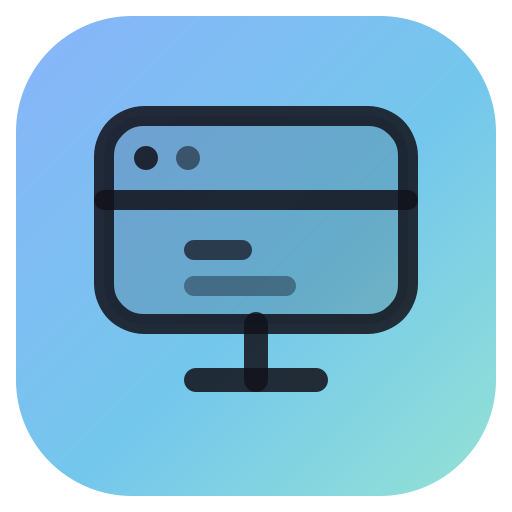
</p>

<h1 align="center">DeskOS</h1>

<p align="center">
  A Python + PySide6 desktop environment companion for Windows 10/11: dashboard,
  dock, launcher, command palette, control centre and a small suite of daily-driver apps.
</p>

<p align="center">
  <a href="docs/BUILDING.md">Building</a> ·
  <a href="docs/ARCHITECTURE.md">Architecture</a> ·
  <a href="docs/PLUGIN_DEVELOPMENT.md">Plugin guide</a> ·
  <a href="CONTRIBUTING.md">Contributing</a> ·
  <a href="CHANGELOG.md">Changelog</a>
</p>

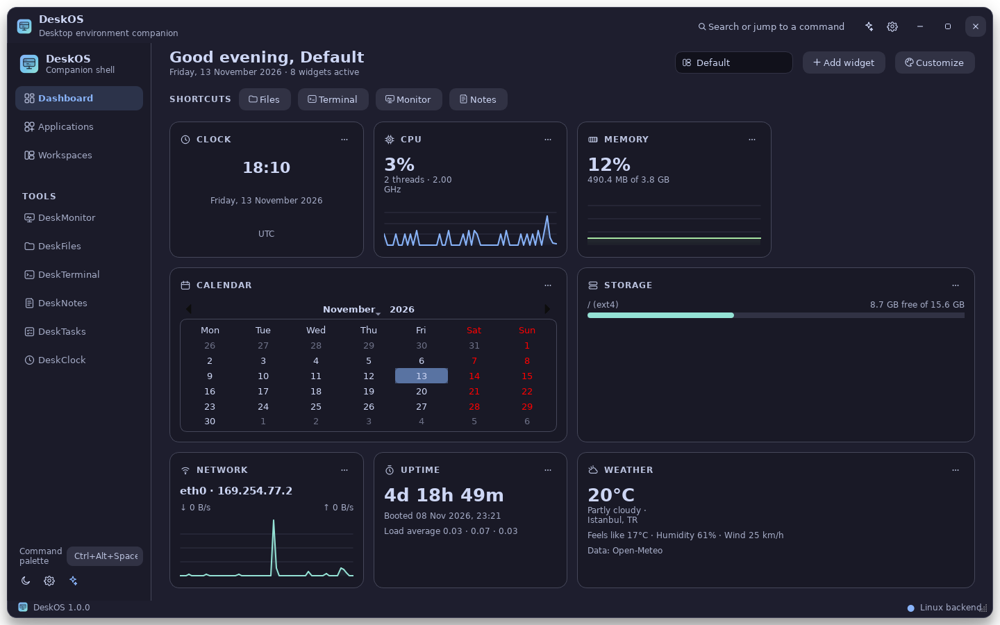

DeskOS is not a replacement shell: it runs as a normal application next to
Explorer. Everything is stored locally — JSON configuration and a SQLite
database under your Windows `%APPDATA%` folder — and there is no account, no
telemetry and no background service.

## Highlights

- **Dashboard** with draggable, resizable widgets: clock, calendar, CPU, memory,
  storage, network, uptime, weather and GitHub activity.
- **Dock** with pins, workspace switcher, clock and live CPU/RAM readout. It can
  sit at the top or bottom, hide itself, and stay on top of other windows.
- **Launcher** (searchable, keyboard driven) that merges by the DeskOS apps with
  the applications actually installed on the machine: Start Menu shortcuts,
  registered executables and Microsoft Store apps on Windows, `.desktop` entries
  on Linux.
- **Command palette** for every action in the program, including user-defined
  shell commands that always ask for confirmation first.
- **Control Centre** for theme, accent colour, wallpaper, scaling, network
  details, autostart, dock behaviour, plugins and configuration backups.
- **Workspaces** with their own pinned commands and widget layouts.
- **DeskFiles, DeskTerminal, DeskMonitor, DeskNotes, DeskClock, DeskTasks** —
  small, focused apps that share the same theme and database.
- **Plugin system** with a documented manifest, declared permissions and two
  working examples (weather forecast and system load).
- **Optional DeskAI** assistant with pluggable providers (OpenAI-compatible,
  Anthropic, local Ollama). It can suggest commands, but never runs one without
  your explicit approval.
- **Graphite (default dark), Catppuccin Mocha and Latte** palettes, switchable at runtime, with twelve accent presets or a custom hex colour picker.
- System metrics are sampled in a background worker; wallpaper scaling is cached between repaints.

## Screenshots

All images are rendered from the real application with
`scripts/capture_screenshots.py`; the values (CPU, storage, uptime, weather,
applications) come from the machine that ran the capture.

| | |
|---|---|
| 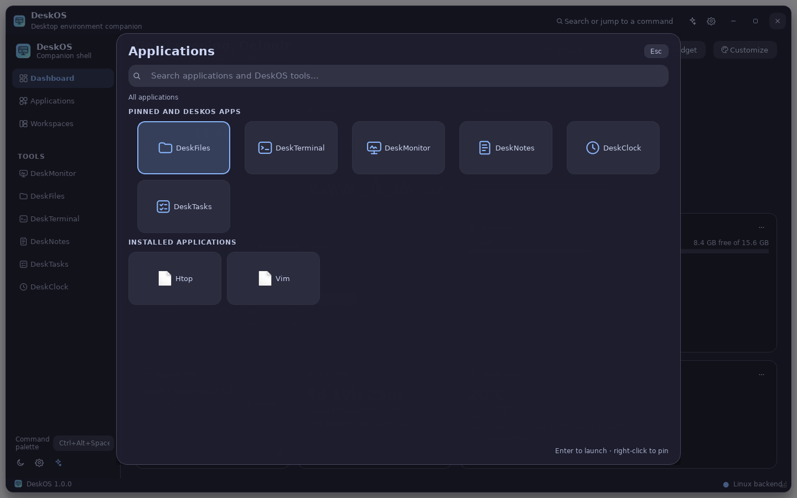 | 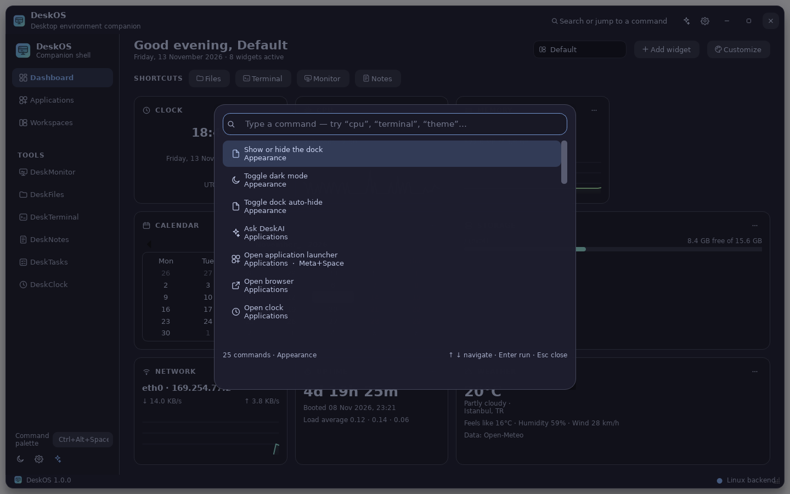 |
| Launcher with installed applications | Command palette |
| 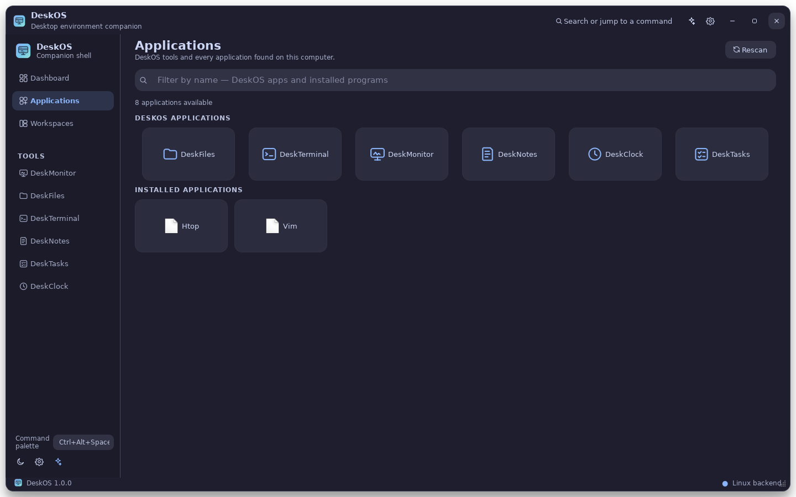 | 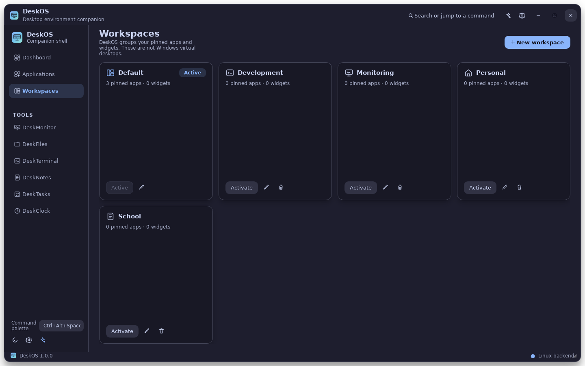 |
| Application browser | Workspaces |
| 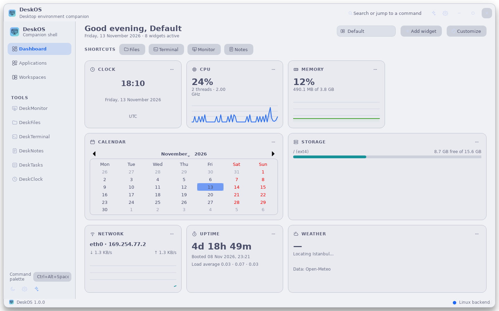 | 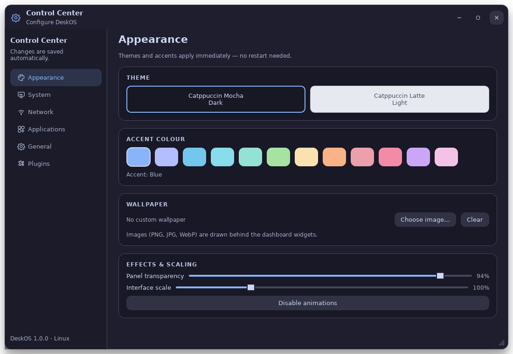 |
| Latte light theme | Control Centre → Appearance |
| 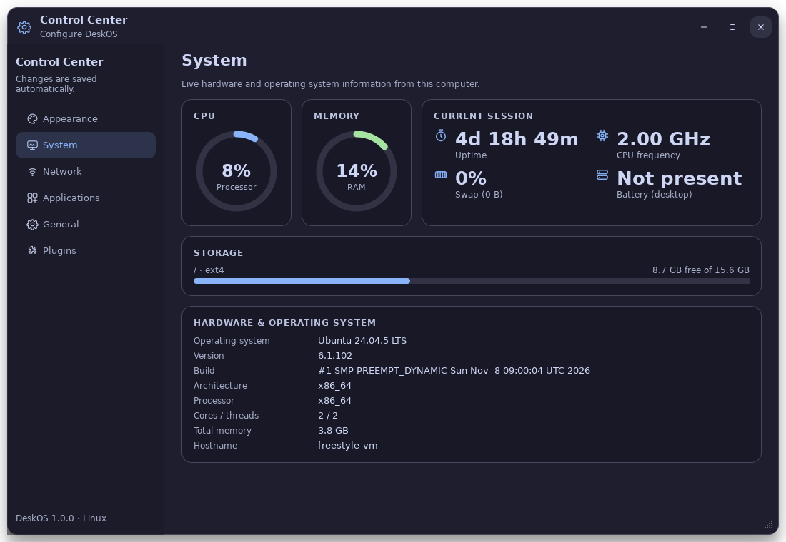 | 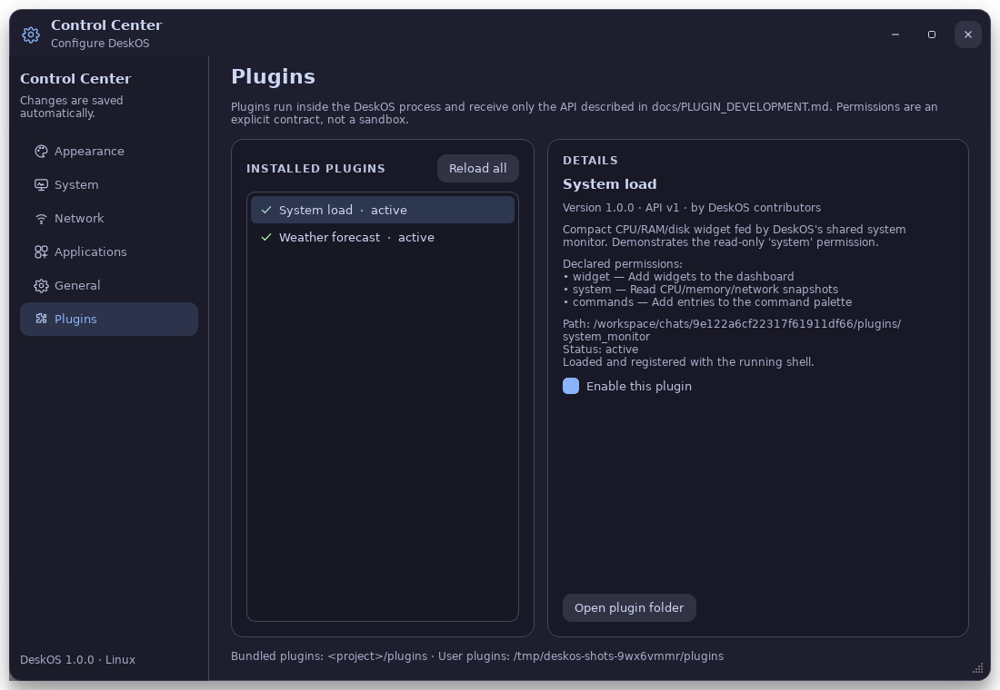 |
| Control Centre → System | Control Centre → Plugins |
| 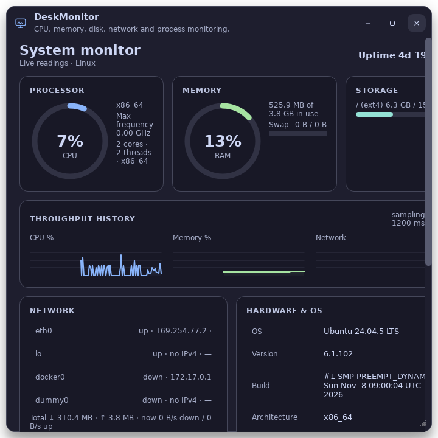 | 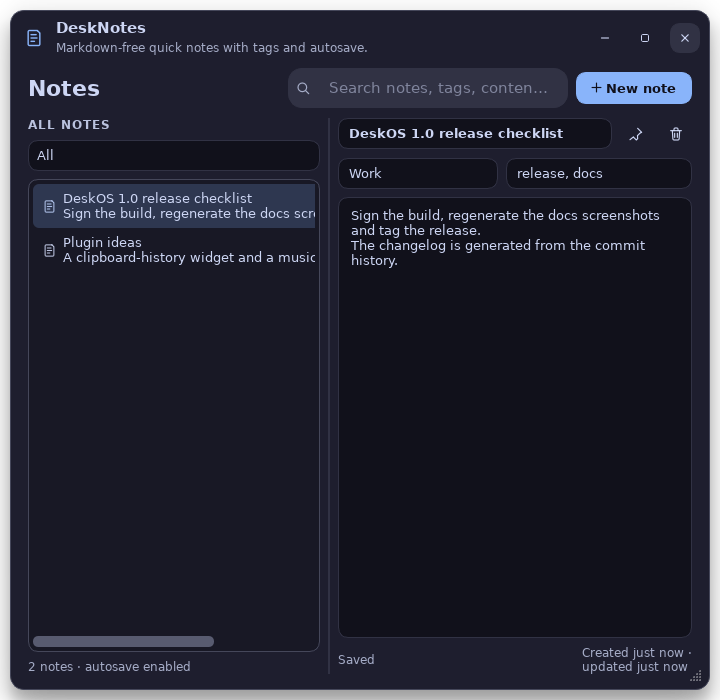 |
| DeskMonitor | DeskNotes |
| 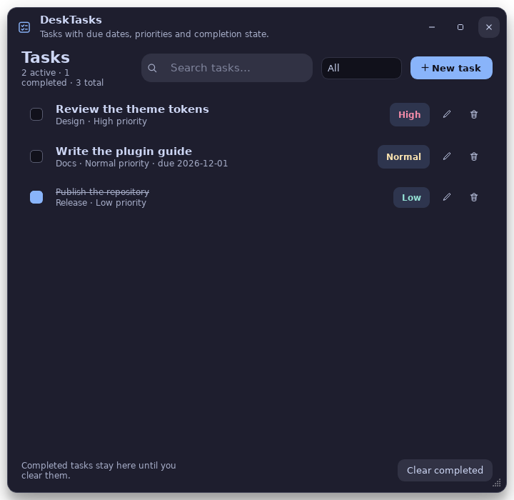 | 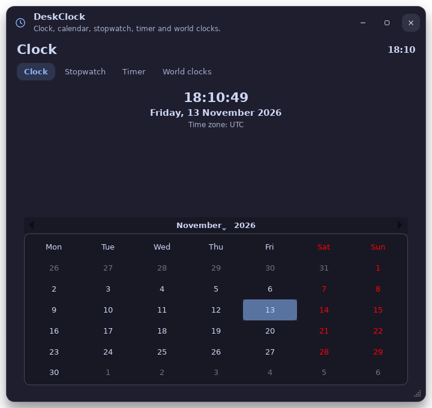 |
| DeskTasks | DeskClock |
| 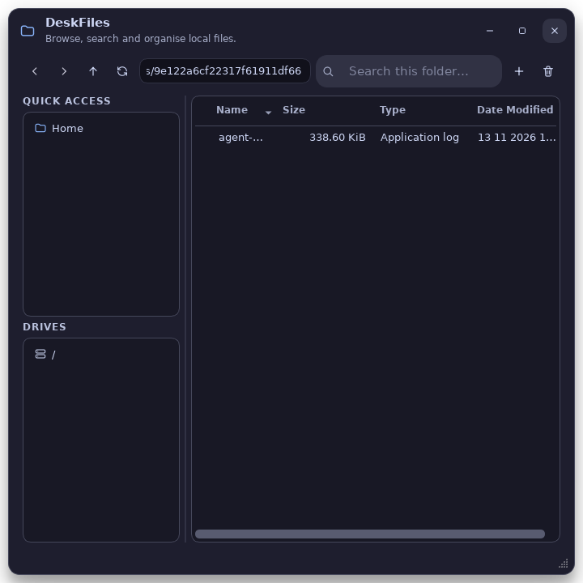 | 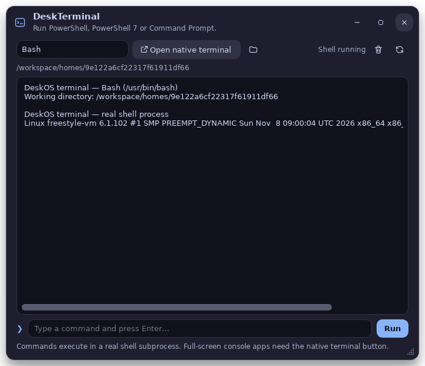 |
| DeskFiles | DeskTerminal |
| 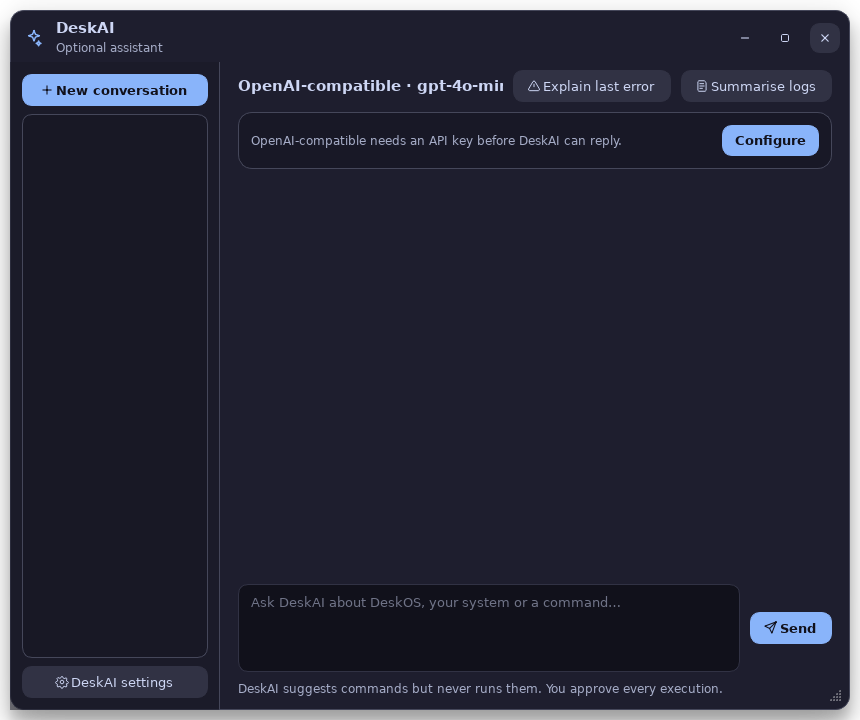 | 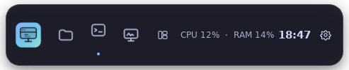 |
| DeskAI (no key configured) | The dock |

## Requirements

- Windows 10 or 11 (primary target), or a Linux desktop for development.
- Python 3.11 or newer.
- PySide6 6.6+, psutil 5.9+ and keyring 24+ (installed from
  `requirements.txt`).

## Quick start (from source)

```powershell
git clone https://github.com/okyanus-11/DeskOS.git
cd DeskOS
py -3.11 -m venv .venv
.\.venv\Scripts\Activate.ps1
python -m pip install --upgrade pip
pip install -r requirements.txt
pip install -e .
python -m deskos
```

Linux:

```bash
python3 -m venv .venv
. .venv/bin/activate
pip install -r requirements.txt
pip install -e .
python -m deskos
```

The first launch creates `config.json`, `deskos.db`, `logs/` and `plugins/`
under the data directory:
`%APPDATA%\DeskOS` on Windows, `$XDG_DATA_HOME/DeskOS` (usually
`~/.local/share/DeskOS`) on Linux. Set `DESKOS_HOME` to use another folder —
the test suite and screenshot renderer rely on this.

## Keyboard shortcuts

| Shortcut | Action |
|---|---|
| `Meta`+`Space` | Command palette (global hotkey on Windows when available) |
| `Ctrl`+`Alt`+`Space` | Command palette fallback, always registered in-app |
| `Ctrl`+`Alt`+`A` | Application launcher |
| `Esc` | Close the launcher, palette or a dialog |

Windows reserves some `Meta` combinations. If `RegisterHotKey` refuses the
configured sequence, DeskOS logs it and keeps the in-app shortcuts working; the
sequence can be changed under Control Centre → General and in `config.json`
(`palette.shortcut`, `palette.fallback_shortcut`).

## What is included

| Area | Contents |
|---|---|
| Shell | Frameless dashboard window, sidebar navigation, status footer, tray menu |
| Navigation | Dock, full-screen launcher, command palette |
| Workspaces | Default, Development, School, Personal, Monitoring; create your own |
| Control Centre | Appearance, System, Network, Applications, General, Plugins |
| Apps | DeskFiles, DeskTerminal, DeskMonitor, DeskNotes, DeskClock, DeskTasks, DeskAI |
| Widgets | Clock, calendar, CPU, memory, storage, network, uptime, weather, GitHub |
| Plugins | Weather forecast (Open-Meteo) and system load (widget + palette command) |
| Data | JSON config with validation and corruption recovery; SQLite with migrations |

### DeskFiles

Browse folders, open files with the system handler, search recursively, copy,
cut, paste, rename, move to the recycle bin (Windows) or trash (Linux), and
inspect file properties. Operations that delete go through the platform layer,
so DeskFiles does not implement its own recursive delete.

### DeskTerminal

A command box connected to a **real** shell process (`pwsh`, `powershell` or
`cmd` on Windows; `bash` or `sh` on Linux) with history, working-directory
tracking and an "Open native terminal" button. It pipes commands into the shell
and renders stdout/stderr; it is **not** a full terminal emulator. Interactive
full-screen programs should be opened in the native console — the button is
there for exactly that.

### DeskMonitor

Live CPU (total and per core), memory, swap, storage, network throughput,
uptime, battery, CPU frequency, and a sortable process table. Sampling is shared
with the dock and dashboard widgets, so one timer feeds all of them.

### DeskNotes and DeskTasks

Notes autosave to SQLite, support tags, pinning and search. Tasks have due
dates, priorities, categories and completion state.

### DeskClock

Clock and date, month calendar, stopwatch with laps, countdown timer and world
clocks.

## DeskAI

DeskAI is optional and disabled until a provider is configured. Providers:

- **OpenAI-compatible** (default): any endpoint that implements
  `POST /chat/completions`, including local gateways.
- **Anthropic Messages API**.
- **Ollama** at `http://localhost:11434` for fully local models.

API keys are stored in the operating system credential store through
`keyring` (Windows Credential Manager). If no keyring backend is available the
key is written to a user-only file (`secrets.json` with `0600` permissions) and
the UI says so; the key is never written into `config.json` and never logged.

The assistant receives a short system context (OS, CPU/memory snapshot, active
workspace, recent log tail when you ask it to explain an error). Suggested
commands are shown as buttons and only run after you confirm them; DeskAI never
executes shell commands on its own.

## Plugins

DeskOS loads bundled plugins from `plugins/` and user plugins from
`<data dir>/plugins/`. Each plugin is a folder with a `plugin.json` manifest and
an entry module that exposes `register(api)`.

Two plugins ship with the repository:

- `plugins/weather` — 3-day forecast widget using Open-Meteo, with per-widget
  city settings and the permission-gated HTTP helper.
- `plugins/system_monitor` — dashboard widget plus a `plugin.system_monitor.snapshot`
  palette command that reports the current load.

Plugins run in-process with the rest of the application. The permissions in the
manifest are an advisory, enforced capability contract for the plugin API (a
plugin without `network` cannot call `api.fetch_json`), **not** a security
sandbox: Python code in a plugin can do anything the DeskOS process can. Only
install plugins you trust. The full contract is in
[docs/PLUGIN_DEVELOPMENT.md](docs/PLUGIN_DEVELOPMENT.md).

## Command line

```
python -m deskos                 # normal start
python -m deskos --safe-mode     # start without plugins
python -m deskos --self-test     # build the shell, verify services, exit
python -m deskos --debug         # verbose logging
python -m deskos --reset-config  # back up and reset config.json
python -m deskos --show-data-dir # print the data directory
python -m deskos --version
```

`--self-test` is used by the build script and CI: it constructs the application,
checks the database, theme, command registry and plugins, then exits with a
non-zero status on failure.

## Configuration

`config.json` is validated on every load. Unknown keys are ignored, out-of-range
values are clamped, missing keys fall back to defaults, and a corrupt file is
moved aside as `config.json.corrupt-<timestamp>` while defaults are written.
Control Centre → General can create a timestamped ZIP backup of the
configuration and database in `backups/`.

The most useful keys:

```jsonc
{
  "appearance": { "theme": "catppuccin-mocha", "accent": "blue", "ui_scale": 1.0 },
  "general":    { "close_to_tray": true, "start_with_dashboard": true },
  "dock":       { "position": "bottom", "autohide": false, "pinned": ["app.files"] },
  "palette":    { "shortcut": "Meta+Space", "fallback_shortcut": "Ctrl+Alt+Space",
                  "custom_commands": [{ "title": "Open projects", "command": "explorer C:\\Projects" }] },
  "ai":         { "provider": "openai", "model": "gpt-4o-mini" }
}
```

`custom_commands` entries always require confirmation before they run.

## Testing

```bash
pip install -e ".[dev]"
QT_QPA_PLATFORM=offscreen python -m pytest
```

The suite contains 160 tests covering configuration validation, database
migrations and repositories, fuzzy matching, theme generation, platform
discovery and launch helpers, plugin loading/permissions/error isolation,
widgets, system sampling, workspaces, AI providers and credential handling,
DeskFiles filesystem operations, Windows hotkey/autostart bookkeeping, GUI
construction, the terminal's real shell round-trip, and full application
startup/shutdown. GUI tests use Qt's `offscreen` platform plugin, so they run
without a display.

## Building a Windows executable

See [docs/BUILDING.md](docs/BUILDING.md). In short:

```powershell
.\scripts\build-windows.ps1
```

This creates a one-folder PyInstaller build at `dist\DeskOS\DeskOS.exe` with
the icons, styles and bundled plugins. The Windows build workflow also wraps
that complete folder in a normal Inno Setup wizard installer:
`DeskOS-Setup-1.0.0.exe`. It installs per-user, creates Start Menu shortcuts,
offers an optional desktop shortcut, and registers a Windows uninstaller. The
installer is unsigned; Windows SmartScreen may show an unfamiliar-app warning.

The [latest release](https://github.com/okyanus-11/DeskOS/releases/latest)
contains the Windows setup installer, the portable Windows archive and the
Linux archive. Main-branch builds are also available for 30 days from the
**Build Windows installer and Linux package** workflow's
[Actions page](https://github.com/okyanus-11/DeskOS/actions/workflows/build.yml).
The Windows job builds on `windows-latest`, runs `DeskOS.exe --self-test`,
silently installs the setup executable, launches the installed app's
self-test, and verifies that uninstall removes program files without deleting
the separate user-data directory.

## Project layout

```
src/deskos/
  app.py            application controller and object graph
  main.py           CLI entry point
  core/             config, database, events, commands, theme, paths
  platform/         Windows and Linux backends (apps, files, hotkeys, autostart)
  services/         application registry, launcher, workspaces, system monitor
  ui/               shell window, dock, launcher, palette, components, chrome
  applications/     DeskFiles, DeskTerminal, DeskMonitor, DeskNotes, DeskClock, DeskTasks
  control_center/   settings pages
  widgets/          dashboard widget framework and core widgets
  plugins/          manifest validation, API, loader, manager
  ai/               providers, credential storage, chat window
plugins/            bundled example plugins
assets/             SVG icon set, generated PNGs and the application icon
docs/               architecture, plugin and build documentation, screenshots
packaging/          PyInstaller launcher and spec file
tests/              pytest suite
```

## Known limitations

- **Windows-specific code paths were not executed on Windows in this build.**
  The repository was developed and verified on Linux (headless Qt). Start Menu
  and registry discovery, the Recycle Bin integration, `RegisterHotKey`
  global hotkeys and the Run-key autostart entry therefore compile and are
  unit-tested with fakes, but have not been run on a real Windows machine.
- The dock is a normal always-on-top window, not a Windows AppBar. It does not
  reserve screen space, so maximised windows can cover it.
- DeskTerminal pipes a shell; it does not allocate a pseudo-terminal, so
  full-screen console applications (vim, top, …) need the native terminal.
- Plugins are in-process and are not sandboxed (see above).
- DeskAI requires your own API key or a local Ollama installation. No model is
  bundled and no request is made until you configure a provider.
- A per-user Windows setup installer is available; it is currently unsigned.
  Automatic updates and a signed MSI remain future work.
- Linux support is a functional fallback (`.desktop` discovery, XDG paths,
  `gio trash`), but Windows is the supported target.

## Roadmap

- Signed MSI installer and automatic updates.
- Optional true AppBar integration for the dock.
- More plugins (clipboard history, media transport) built on the stable API v1.
- A pseudo-terminal backend for DeskTerminal on Windows.

## License and credits

DeskOS is released under the MIT License (see [LICENSE](LICENSE)).
The Catppuccin palettes are from the Catppuccin project (MIT). Icons are
original SVGs drawn for DeskOS. Weather data comes from
[Open-Meteo](https://open-meteo.com/); installed-application icons are read from
the system and are not redistributed.

## Installation

Requires Python 3.11+; Windows 10/11 is the primary target. Clone the repository, create and activate a virtual environment, install `requirements.txt`, install the project with `pip install -e .`, then launch with `python -m deskos`. See the [full installation guide](INSTALLATION.md) for Linux development notes and data-directory details.
